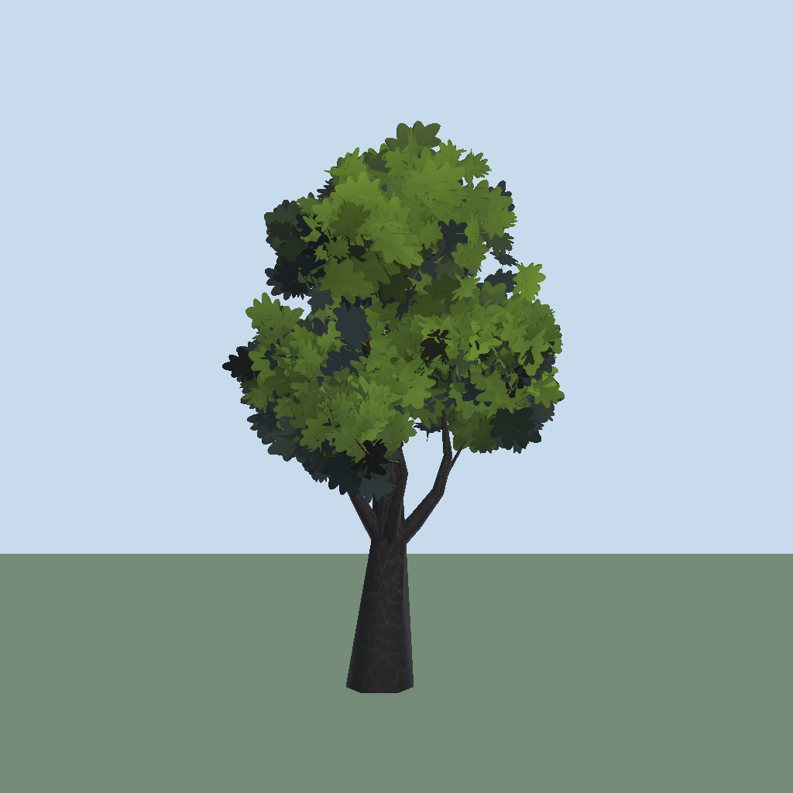

# Getting started

[Back to README](../README.md)

## Install and set up

1. Add the package from `https://github.com/Meowdieval-Kingdom/MeowFoliageForge.git` (Package Manager > Add package from git URL). Unity 6000.0+, URP 17+.
2. The **Setup Wizard** opens by itself once per project. Apply the *Required* rows (see [Setup](setup.md)).
3. Open `Meowdieval > Foliage Forge > Foliage Forge Editor`.

## First tree

1. Press **New** and pick a preset: Oak, Dead, Maple or Spruce. The **Textured** toggle next to the Preset menu decides whether the preset loads leaf, bark and moss textures (off: flat solid cards). **Swap Textures** switches the current recipe between both without resetting anything else.
2. Edit the settings on the left. The tree rebuilds as you edit.
3. Navigate the preview: drag to orbit, scroll to zoom, double-click to reset.
4. **Bake Prefab** writes `<recipe name>/` (mesh, bark material, leaf material, prefab, LOD meshes) into the output folder. Default is `Assets/Foliage Forge`; change it with **Folder...** under the preview.



## Window tour

- **Toolbar row 1**: Trees | Grass tab, Recipe / Profile field, **New**, **Save As New...**, **Bake**.
- **Toolbar row 2**: Preset and Reroll Seed (Trees) or Biome, Quality, Reroll Seed and batch size (Grass), plus **Foliage Brush** and **Setup Wizard** buttons.
- **Preview**: the View bar above it holds Ortho, Ground and Wind. Direction and Strength live in their own Wind panel. Modes: **Finished**, **Wireframe** (wood as lines), **Blobs** (wood plus editable canopy blobs), **Variants** (variants side by side). **Backlit** moves a low sun behind the tree to show translucency.
- **Prefabs strip**: lists every baked tree and grass batch. Filter All / Trees / Grass. Click picks a tile; double-click or Load opens it (switching tab); double-click also shows it in the Project.
- **Stats**: triangle count against `Budget.MaxTriangles`.
- With nothing picked you edit an unsaved scratch tree or profile; a banner over the inspector says so and offers **Save...**.

## Wind

Add one **Foliage Wind** component to the scene. Direction is in degrees around Y. It sets the global shader values `_FF_WindDir` (xyz direction, w strength) and `_FF_WindParams` (speed, gust frequency, gust contrast), used by trees and grass alike.

## Place it in a scene

`GameObject > Meowdieval > Foliage Forge` creates a **Meowdieval Foliage Forge** prefab with a manager, a paint-only Grass Field and a Props root. Open the [Foliage Brush](brush.md) and paint.

## Code API

```csharp
recipe.ApplyPreset(TreePreset.Oak, textured: true);
recipe.SetTextured(false);
TreeStats stats = TreeGenerator.Build(recipe, mesh);
GameObject prefab = TreeBaker.Bake(recipe);        // recipe must be a saved asset
```

Everything except the runtime assembly (manager, wind, grass) is editor-only.
