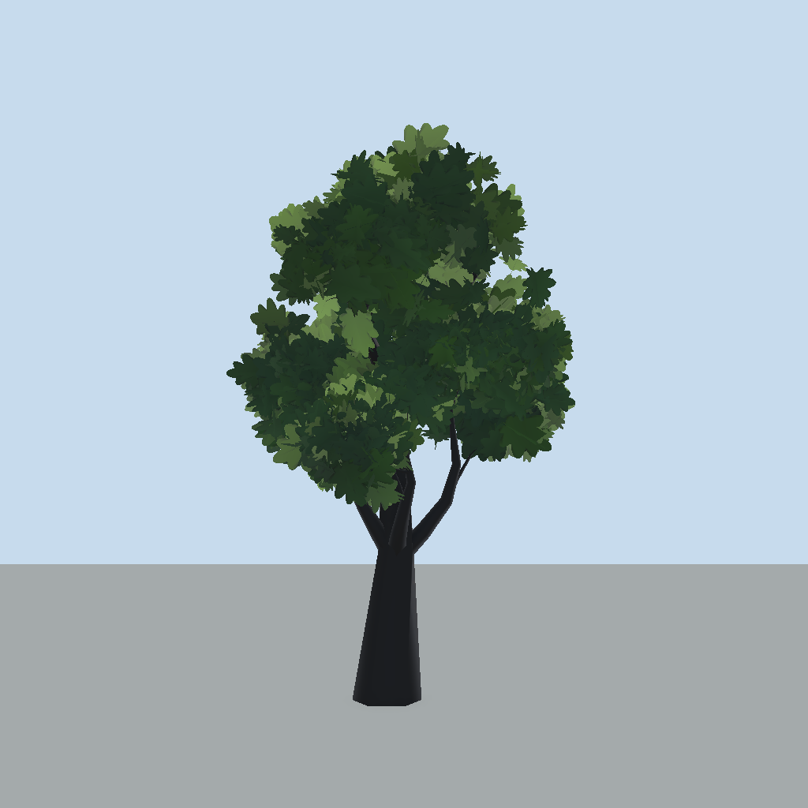

# Leaves, look and shaders

[Back to README](../README.md)

The **Look** tab holds colour, lighting and texture settings. They are written into the tool-made materials on every bake and shown live in the preview. Assign your own materials (Look tab > Leaf material, Bark and moss > Bark, Core shell > Core Material) to opt out. Fields tagged (Advanced) sit behind the section's **Advanced** chip; the search field filters all tabs (see [Trees](trees.md#find-a-setting)).

## Shader Graphs

- `FoliageForge` (leaf cards): height gradient (bottom to top colour), per-card flutter, scrolling leaf texture, global wind.
- `FoliageForgeBark` (trunk and branches): bark texture, height gradient, moss.
- Both share `Shaders/FoliageForge.hlsl`; the graphs call it through Custom Function nodes. Wind values: `_FF_WindDir` (xyz dir, w strength) and `_FF_WindParams` (speed, gust frequency, gust contrast).
- Grass uses a hand-written shader, see [Grass](grass.md).

## Mesh layout

- Submesh 0 = wood, submesh 1 = leaf cards. Two draw calls per tree (a Core shell adds its own submesh and material).
- Vertex colour: **R** height 0..1, **G** sway weight, **B** 1 on leaf cards (crown-interior AO when Renormalize is on), **A** per-branch random.
- UV1 on leaf cards: xyz pivot (object space), w flutter phase.
- UV2/UV3: card axes, written (+32 bytes per vertex) only when Billboard is not Off.

## Foliage tab fields that affect the look

### Cards

Where: Foliage > Cards.

- **Cards fit the texture**: the generator measures the opaque part of the leaf texture (alpha > 0.5) and maps the card to it, so transparent padding does not shrink the leaf. Card size is the longer side of that part.
- **Roll** / **Roll Jitter**: 0 keeps the texture top up, 180 hangs it, jitter 180 allows any rotation.
- **Anchor**: which texture point sits on the branch (default bottom middle = the stem). Use (0.5, 0.5) for star-shaped sprays. A small picture of the leaf under the fields shows a red dot; click or drag in it.
- **Billboard**: Off keeps fixed cards (default; fine with orthographic cameras). ViewAligned turns every card to the camera, YAxis only around the vertical axis. Costs 32 bytes per vertex.

### Shading and Renormalize

Where: Foliage > Shading. See [Trees](trees.md#shading). **Normal Blend** sets how much lighting follows the round crown instead of each flat card.

## Look tab

### Leaf color

Where: Look > Leaf color.

| Field | Effect |
|---|---|
| Leaf Texture | Monochrome cutout texture, alpha = cutout. Empty uses a generated placeholder |
| Leaf Bottom, Leaf Top | Dark-to-light colour gradient up the tree |
| Gradient Bias | Above 1 keeps the lower crown dark longer, below 1 brightens sooner |
| Gradient Jitter | Random per-card shift of the ramp so it does not read as a clean gradient |
| Color Variation | Per-branch warm/cool tint and brightness (0-1, default 0.5; warm yellow to cool green) |
| Solid Cards, Solid Shape | Ignore the texture alpha: flat opaque cards. Shape: Square, Round Soft (noise-eroded round blob), Leaf |
| Continuous Color | Blobs look: tint, brightness and gradient follow world-space noise and height inside each blob, so cards melt into one mass |
| Grain Amount (Advanced) | Fine world-space breakup of colour and light; needs Continuous Color. 0 = off |

### Lighting

Where: Look > Lighting.

- **Translucency** (amount, **Translucency Color**, **Translucency Focus**): light through the leaves toward the camera, `pow(dot(view, -(L + N*0.3)), focus)`, strongest when the sun is behind the tree. Unshadowed emission, so it also lights leaves shaded by the crown above. Needs a directional main light. Use the **Backlit** button in the preview to see it; with a high sun it barely shows.
- **Wrap**: adds the part of `N.L * 0.5 + 0.5` that plain Lambert lacks as unshadowed emission from the main light, so shaded sides stay soft. 0 = off.

### Stylized

Where: Look > Stylized. Gated by **Stylized Shading** (off by default; sliders keep their values while off, and the fields below are hidden until it is on):

| Field | Effect |
|---|---|
| Shadow Color, Shadow Amount, Shadow Softness | Coloured shadow side with a soft band; low softness = toon edge. Amount 0 = off |
| Bands | Steps light into 2-5 flat tones following the smooth blob normals. 0 = smooth |
| Sky Tone | Lets the blob's smooth normal drive the dark-bottom to light-top ramp. 0 = off |
| Rim Color, Rim Strength, Rim Power | Fresnel edge on clump edges; Strength 0 = off |
| Hue Shift | Lit side warmer, shadow side cooler |
| Tree Variation | Per-tree hue and brightness from the object position, so copies differ |

### Patches and fill (Advanced)

Where: Look > Patches and fill (advanced section, behind the Leaf color Advanced chip; needs Stylized Shading on).

| Field | Effect |
|---|---|
| Patch Color, Patch Amount, Patch Scale | World-space noise patches (dry, autumn) over the leaves. Alpha of the colour = strength; Amount 0 = off; Scale = noise cells per metre |
| Fill Texture, Fill Scale, Fill Impact | Painterly texture tiled in world space over every card so neighbours do not repeat one leaf. Empty = off |

### Core shell

Where: Look > Core shell. Blobs layout: **Core Mesh** adds a slightly inset smooth shell per blob (own submesh and material) that fills gaps between cards. **Core Align** also trims the core on the side Placement Bias leaves bare. **Core Segments** = longitude segments (rings follow at 70%); triangles per blob = 2 x segments x rings. **Core Material**: empty = tool-managed.

### Bark and moss

Where: Look > Bark and moss. **Bark** (material), **Bark Texture** (monochrome, mapped on the mesh UVs: u around, v along the wood, so it moves with the sway), **Bark Bottom**, **Bark Top** (height gradient), **Bark Tiling**.

(Advanced) **Moss** on upward-facing surfaces: Moss Texture (optional breakup mask), Moss Color, Moss Amount (0 = none), Moss Sharpness, Moss Tiling.

### Leaf material

Where: Look > Leaf material. Your own leaf material; empty = tool-managed.

## Textures

See [Textures](textures.md) for rules and the per-preset list. Presets can load without any texture (the window's **Textured** toggle, `ApplyPreset(preset, false)`): flat solid cards.

## Performance notes

- Cards are fixed quads with blended normals; billboarding is optional.
- Renormalize and AO baking cost nothing at runtime.
- Keep the Budget caps in mind: Intersecting and Card Shape multiply triangles.
