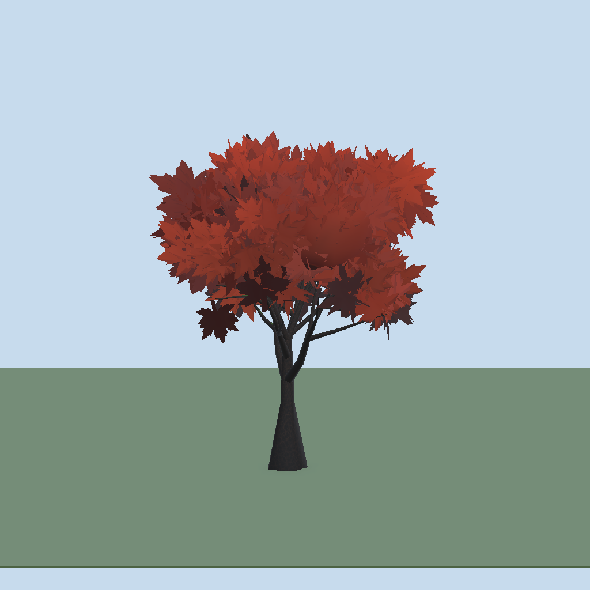
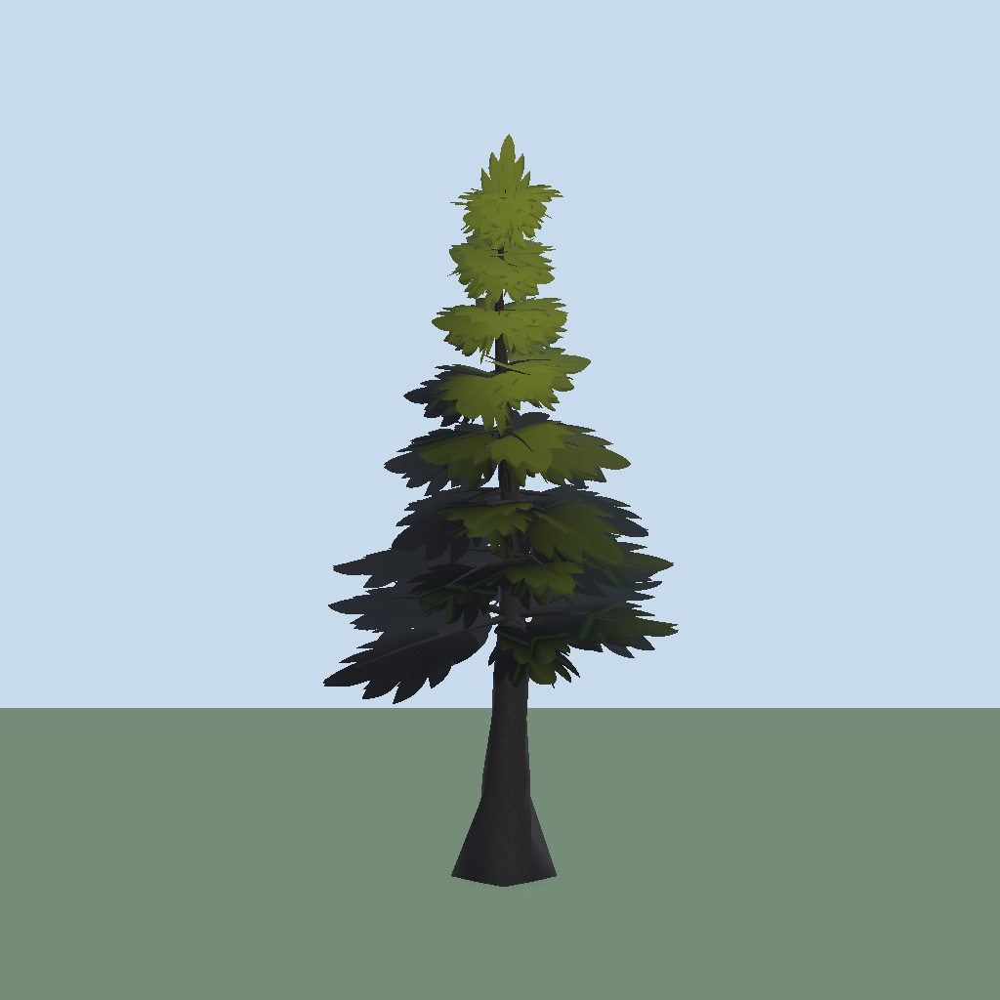

# Trees

[Back to README](../README.md)

A tree is a `TreeRecipe`: a seed plus settings. The recipe inspector (and the Foliage Forge window's recipe panel) groups them into four tabs: **Shape**, **Foliage**, **Look** and **Output**. This page follows that order. Look settings are in [Leaves, look and shaders](look-and-shaders.md); Output settings are in [Variants and LODs](variants-and-lods.md).

Structure features below default to **off**, so older recipes build the same mesh. They use hashes and Perlin noise instead of the seed's random stream, so turning one on does not reshuffle the rest of the tree.

| Maple | Spruce |
|---|---|
|  |  |

## Find a setting

- **Search field** (above the tabs) filters every tab by field label or tooltip. While you search, the tab buttons show match counts, matching sections open, and Advanced toggles are ignored.
- **Advanced chip**: sections with rarely needed fields have an **Advanced** chip at the top. It reveals those fields, or whole advanced sections, for that section only. Fields tagged (Advanced) below sit behind it.
- Fields that do not apply are hidden: Blobs-only fields outside the Blobs layout, branch fields at 0 levels, split fields at 0 splits, Stylized fields while Stylized Shading is off.
- **Seed** and **Reroll** sit above the tabs.

## Presets

Pick one from the window's **Preset** menu. It overwrites shape, leaf and look values; your textures and materials stay. Available: Oak, Dead, Maple, Spruce, Twisted, CottonCandy, Bush, Hedge, Fir, Sapling, Cherry, Poplar, HedgeHigh.

- **Oak**: blob canopy filled with small cards, split stems and roots.
- **Maple**: blob canopy, multi-stem trunk.
- **Spruce**: fronds layout (conifer sprays).
- **Dead**: broken stubs and exposed roots, no leaves.

## Shape tab

### Trunk

Where: Shape > Trunk. Height, Base Radius, Tip Radius Ratio, Bend, Lean, Flare.

### Trunk detail (Advanced)

Where: Shape > Trunk detail (advanced section, behind the Trunk Advanced chip).

| Field | Effect |
|---|---|
| Radial Sides, Height Segments | Mesh resolution of the trunk |
| Taper Power | How fast the trunk thins. Low keeps it thick (chunky), high thins early |
| Twist | Degrees the trunk turns base to top; spirals the bark, root lobes and gnarl |
| Gnarl | Perlin bumps along all wood, as a share of the radius |
| Noise Bend, Noise Frequency | Bend the wood along Perlin noise; the base stays put |

### Splits and Roots (Advanced)

Where: Shape > Splits and Roots (advanced section, behind the Trunk Advanced chip).

| Field | Effect |
|---|---|
| Splits | Cuts the trunk into Splits + 1 stems. 1 = Y fork. Branches and crown tops spread over the stems |
| Split Height, Split Angle | Where the split happens and how far stems lean out. Shown only when Splits > 0 |
| Braid | Turns the stems around each other; low split + braid = braided multi-stem. Shown only when Splits > 0 |
| Root Lobes, Root Lobe Depth, Root Lobe Height | Buttress ridges at the base. Root Lobes rounds the radial sides up to a multiple of it |
| Roots, Root Length, Root Radius, Root Wander, Root Curl | Exposed, half-buried roots that arch out of the base and curl up at the tip |

### Branches

Where: Shape > Branches. Levels (0-2; level 1 grows from the trunk, level 2 from level 1), Count, Start End, Pitch Range, Length Ratio, Length Profile, Radius Ratio. With Levels 0 the other branch fields are hidden.

### Branch detail (Advanced)

Where: Shape > Branch detail (advanced section, behind the Branches Advanced chip).

| Field | Effect |
|---|---|
| Segments, Min Sides | Branch mesh resolution. Normals stay round, so more sides only rounds the silhouette |
| Sub Count, Sub Length Ratio | Level-2 twigs per branch. Shown at Levels 2 |
| Whorl Size | Branches per ring: 1 spirals, 5 gives conifer whorls |
| Yaw Step | Degrees between branches around the trunk. 137.5 = golden spiral. Ignored with whorls |

Subsection **Wobble**: Wander, Noise Bend, Noise Frequency, **Length Noise** (smooth length variation around and along the trunk), Droop.

Subsection **Character**: **Asymmetry** grows the lean side longer; **Broken** snaps that share of level-1 branches into short jagged stubs without leaves.

## Foliage tab

### Layout

Where: Foliage > Layout. **Layout** picks the generator:

| Layout | Result |
|---|---|
| **Clusters** (default) | Cards scattered around each end branch. **Attach** 0 scatters, 1 grows every leaf from a branch point |
| **Fronds** | Long cards along every end branch (conifer sprays). Cards Per Branch = fronds per branch, fanned by Roll Jitter; Fold droops them; plus a crossed leader on top |
| **Hanging** | Strands of cards (**Strand Length**) straight down from each end branch; Roll 180 hangs leaves tip-down |
| **Blobs** | Fills hand-editable ellipsoids, see Blobs below |

Other fields: Cards Per Branch, Cluster Radius, Tip Bias, **On Inner Branches** (leaves on level-1 branches too) are for the branch layouts; **Groups per blob** is the Blobs-layout card count.

### Blobs

Where: Foliage > Blobs (Blobs layout only). Holds the **Canopy Blobs** list, an inset viewer, and the Auto Blobs settings: Blob Count, Blob Size, Blob Overlap, Blob Size Spread, Blob Flat Belly, Blob Taper, Branch Follow.

In the window's **Blobs** view mode:

- **Auto Blobs** spreads Blob Count blobs over the branch tips. An empty list is suggested on the fly.
- Drag a blob to move it. Scroll resizes it (Ctrl: height only). Delete key or button removes it. **Add Blob** adds one.
- Select a blob to see its **cage** (26 points). Drag a point to reshape the blob (Shift: neighbours follow half as far); cards then fill the cage. **Reset Shape** returns to an ellipsoid.

### Leaf groups (Advanced)

Where: Foliage > Leaf groups (advanced section, behind the Blobs Advanced chip; Blobs layout only). A leaf group is Group Quads intersecting quads fanned around the blob surface normal.

| Field | Effect |
|---|---|
| Coverage | Automatic group count (Groups per blob = 0): layers of leaf area over the blob surface |
| Group Volume | 0 = hollow shell, 1 = groups also fill the interior |
| Group Quads | Quads per group |
| Group Depth, Group Jitter | Anchor depth below the surface; random anchor spread along it |
| Group Tilt, Group Tilt Jitter | Angle between group axis and surface normal; random spread (spiky outline) |
| Normal Offset | Pushes groups off the blob surface, in metres (fuzzy outline) |
| Branch Tip Bias | Pulls groups toward branch tips inside the blob |
| Placement Bias | -1 under each blob, 0 all around, 1 on top |
| Smoothness | 1 = every vertex of a group uses the blob surface normal (ball-like shading) |

### Cards

Where: Foliage > Cards. Card Size, Aspect, Anchor (with the anchor picker), Roll, Roll Jitter, Up Bias, **Intersecting** (a second card through each one, turned 90 degrees; on by default, doubles the cards and the budget counts both), Cards Per Cluster (0 follows Intersecting; multiplies the card count), Billboard, Crown On Trunk Top. Details of Roll, Anchor and Billboard are in [Leaves, look and shaders](look-and-shaders.md).

Subsection **Leaf Shapes** (Advanced):

- **Sprite Sheet** (Columns, Rows): each cell is trimmed on its own, empty cells skipped, every card picks a random cell.
- **Card Shape** (Width Segments, Length Segments, Fold, Curl, Twist, Jitter): cards become grids that **Fold** along the middle, **Curl** along the length and **Twist**, with per-card Jitter. Shaped cards cost `2 * width * length` triangles each. LOD1 halves the segments, LOD2 uses flat quads. Billboards flatten shaped cards.

### Crown and clumps

Where: Foliage > Crown and clumps.

- **Envelope** (None, Sphere, Dome, Cone, Column, Umbrella) pulls leaves onto that silhouette and prunes level-1 branches to it; **Envelope Strength** 0..1.
- **Clumps** gathers cards into N puffy blobs (**Clump Gather**); 0 = off. **Tint Per Clump** tints per blob.
- **Tip Clumps**: one puff per branch tip with bare wood leading into it; ignores Clumps.
- **Clump Height** squashes clumps; **Shell** puts cards on the clump surface; **Flatten Bottom** makes a shelf look. Shell and Flatten Bottom are hidden in the Blobs layout.

### Shading

Where: Foliage > Shading. **Normal Blend** (how much lighting follows the round crown instead of each card; scales Renormalize and Puffiness too) and **Puffiness** (clump-ball normals, applied after Renormalize; hidden in the Blobs layout).

**Renormalize** (Advanced, hidden in the Blobs layout): Enabled, Tightness, Strength, AO Strength. It replaces leaf normals with a smoothed density-proxy shell and bakes crown-interior AO into leaf vertex colour B. It runs at generation time and costs nothing at runtime.

## Look tab

Leaf color, Lighting, Stylized, Patches and fill, Core shell, Bark and moss and Leaf material: see [Leaves, look and shaders](look-and-shaders.md).

## Output tab

Budget and collider, LODs, Type and variants: see below and [Variants and LODs](variants-and-lods.md).

### Budget and collider

Where: Output > Budget and collider. **Max Cards** is a hard cap. **Max Triangles** is the whole-tree budget; with **Fit Cards To Triangles** on, cards are reduced until the tree fits, sooner when shaped cards or Intersecting are on. The window shows the triangle count against it. **Add Trunk Collider** adds a capsule collider to the baked prefab.
