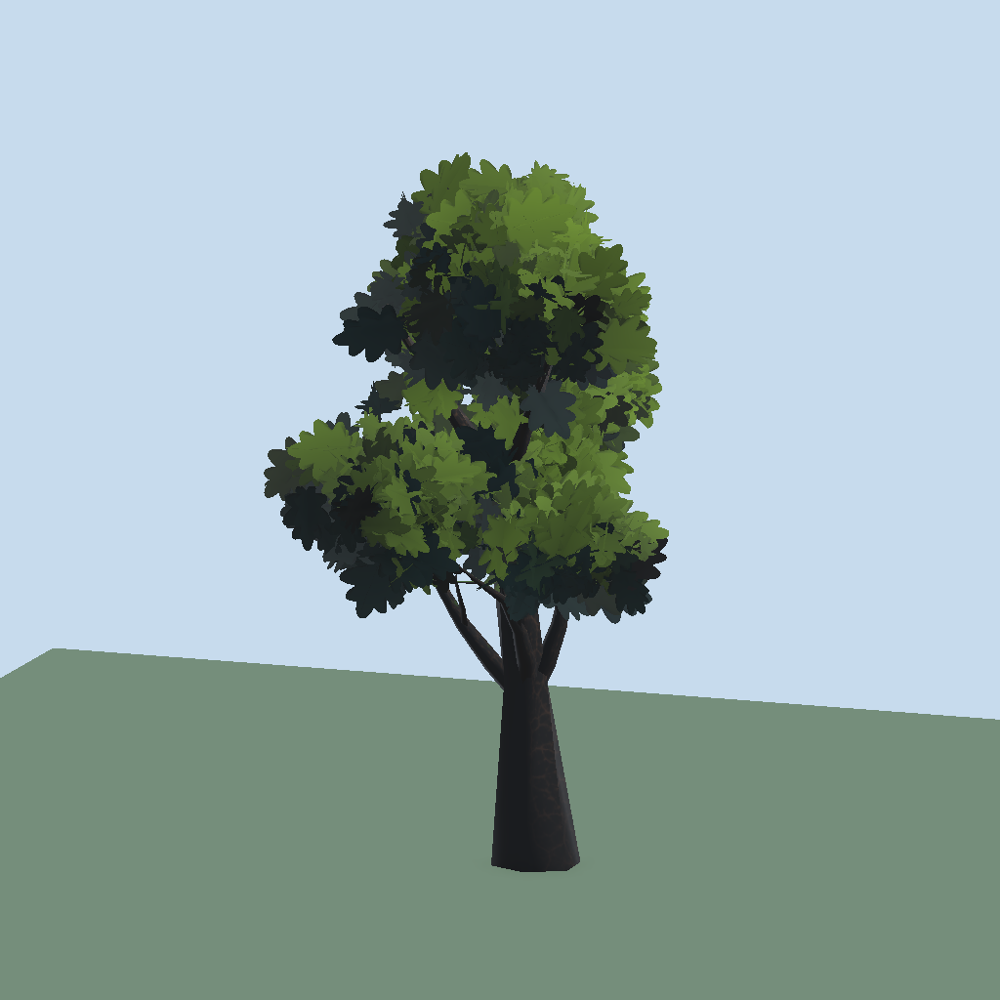

# Variants and LODs

[Back to README](../README.md)

## Type Id

Recipe > Output > **Type & Variants** > **Type Id** is the tree's type name, e.g. `Oak`. Applying a preset sets it unless you typed your own. *Origin Preset* beside it only shows the last preset used.

## Variants

- **Create 3 Variants** adds three entries, each with a **Seed**, a **Scale Multiplier** and a **Blob Count Delta** (-1..+1, Blobs layout; at least 1 blob stays).
- **Reroll Seeds** picks new seeds.
- Variants are applied to a temporary copy when generating, so the recipe itself never changes. On a Blobs layout the blobs are re-suggested for each variant's branches; hand-edited blobs apply to the plain recipe only.
- The window's **Variants** view shows them side by side.

## Bake All Variants

Window row 2 writes into the recipe's output folder:

- `<Name>_V1.prefab`, `_V2`, ...
- `<Name>_Variants.asset`, a **Tree Variant Set**: Type Id, the prefabs, a weight per prefab (default 1).

Variants share the recipe's two materials. Prefabs of removed variants are deleted; set weights are kept.

Add a Tree Variant Set to the Foliage Forge Manager's *Variant Sets* list to use it in the [brush](brush.md): each set counts as one palette entry at Mix 100%, and every placement picks a weighted random prefab from it.

## LODs

Recipe foldout **LODs**. Bake writes `<name>_LOD1.asset` and `<name>_LOD2.asset` and adds an `LODGroup` to the prefab (LOD0 is the root renderer, LOD1 and LOD2 are child objects).

| Level | Contents |
|---|---|
| LOD0 | Full tree |
| LOD1 | Drops the twig level, keeps `Lod1CardShare` of the cards at larger size, halves shaped-card segments |
| LOD2 | Plain trunk, `Lod2CardShare` of the cards, crossed when `Lod2Intersecting` is on, flat quads |

Transitions are screen heights. The simplified meshes use the same seed but a different random stream, so the silhouette is close, not identical. Enable **LOD Cross Fade** in the URP asset (the [Setup Wizard](setup.md) checks it).
