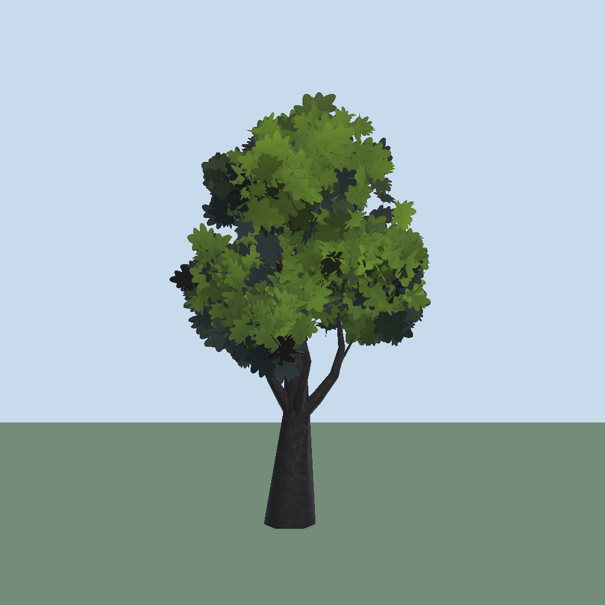
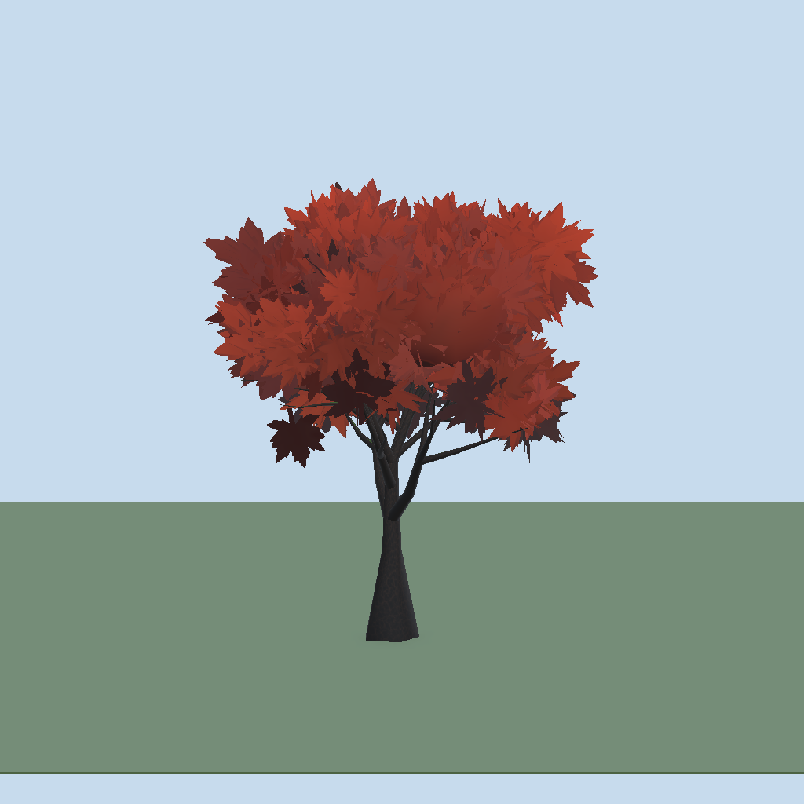
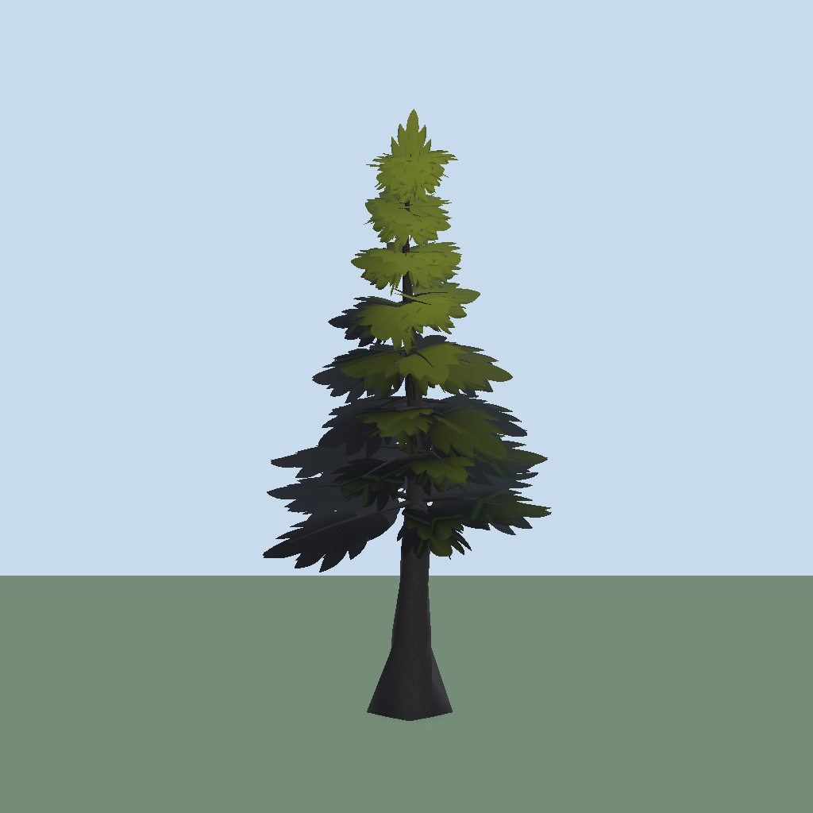
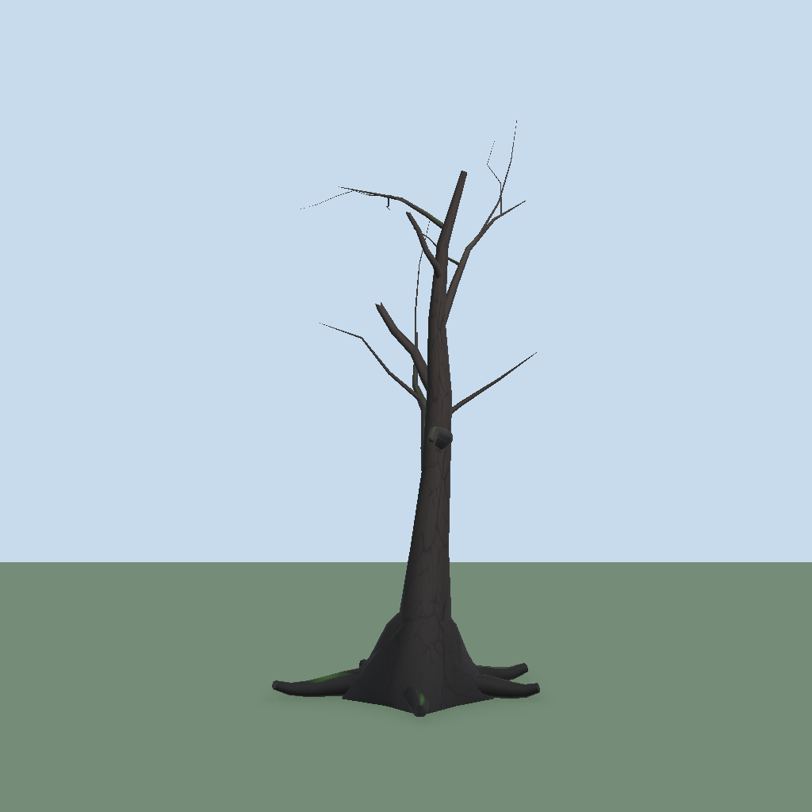
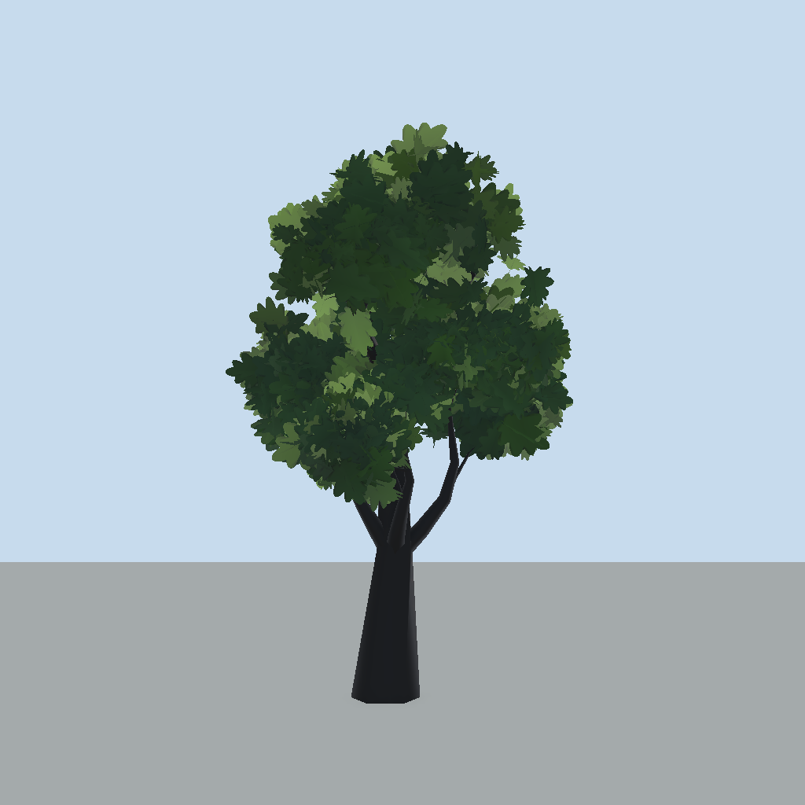
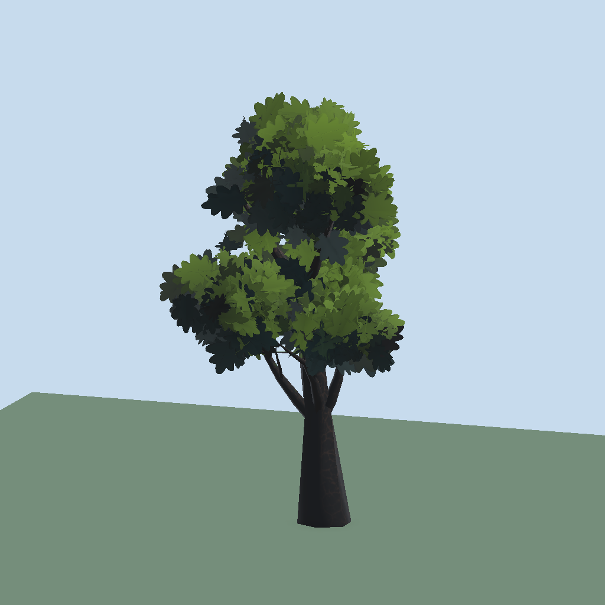

# Foliage Forge


Procedural stylized foliage for Unity (URP). Design a tree as a **recipe** (seed + settings), bake it to a mesh and prefab, and place it with a scene brush. Add GPU-instanced grass on top. Trees are baked in the editor; nothing generates at runtime.

| Oak | Maple | Spruce | Dead |
|---|---|---|---|
|  |  |  |  |

*The four built-in presets, baked with default settings and rendered with the package's own materials (textured presets, orthographic camera, URP).*

## Highlights

- **Recipe to prefab**: one `TreeRecipe` asset per tree. Edit it live in the **Foliage Forge** window, press **Bake Prefab**, get mesh + two materials + prefab + LODs.
- **Two draw calls per tree**: submesh 0 wood, submesh 1 leaf cards. Hard budgets for cards and triangles.
- **Stylized look**: height gradient, per-clump colour variation, three-tone shadow banding, rim light, translucency, wrap light, moss on bark. All in two Shader Graphs.
- **Many ways to shape a crown**: envelopes, clumps, hand-editable canopy **blobs** with deformable cages, fronds for conifers, hanging strands, sprite sheets, folded and curled cards.
- **Variants and LODs**: bake sets of seed variants, automatic `LODGroup` with cross fade.
- **GPU grass**: instanced clumps with wind, trample, ground-colour tint, distance LOD and a biome system.
- **Foliage Brush**: paint trees, grass and any prefab into the scene with weighted palettes.
- **Searchable settings**: tabs, a search field and per-section **Advanced** toggles keep the editors short.
- **Setup Wizard**: checks the URP asset, layers and shaders and fixes them in one click.

## Requirements

- Unity **6000.0** or newer
- Universal Render Pipeline **17.0.0+** and Shader Graph **17.0.0+** (declared as package dependencies)

## Install

Package Manager > **+** > *Add package from git URL*:

```
https://github.com/Meowdieval-Kingdom/MeowFoliageForge.git
```

Or in `Packages/manifest.json`:

```json
"com.meowdieval.foliageforge": "https://github.com/Meowdieval-Kingdom/MeowFoliageForge.git"
```

To develop on it, clone the repo and point the manifest at the folder: `"com.meowdieval.foliageforge": "file:../path/to/MeowFoliageForge"`.

After import the **Setup Wizard** opens once. Apply the *Required* fixes, then you are ready.

## Quick start

1. `Meowdieval > Foliage Forge > Foliage Forge Editor`.
2. Pick a **Preset** (Oak, Maple, Spruce, Dead) in the toolbar's second row, or under **More** in a narrow window.
3. Edit settings on the left (tabs, search, **Advanced**); the preview rebuilds as you type. Drag to orbit, scroll to zoom, double-click to reset.
4. **Bake Prefab** writes `Assets/Foliage Forge/<recipe name>/` (mesh, bark and leaf materials, prefab).
5. `GameObject > Meowdieval > Foliage Forge` adds a manager; open the **Foliage Brush** and paint.
6. Add one **Foliage Wind** component to the scene so everything sways.

Full walkthrough: [Getting started](Documentation~/getting-started.md).

## Documentation

| Page | Covers |
|---|---|
| [Getting started](Documentation~/getting-started.md) | First tree, baking, wind, placing it in a scene |
| [The window](Documentation~/window.md) | Toolbar, settings pane, preview modes and controls, gallery, responsive layout |
| [Trees](Documentation~/trees.md) | Trunk, branches, roots, crown shape, blobs, fronds, budgets |
| [Leaves, look and shaders](Documentation~/look-and-shaders.md) | Cards, textures, gradient, stylized shading, translucency, mesh layout, wind |
| [Variants and LODs](Documentation~/variants-and-lods.md) | Type Id, seed variants, variant sets, LOD meshes |
| [Grass](Documentation~/grass.md) | Grass field, profile, types, biomes, features, trample, baked batches |
| [Foliage Brush](Documentation~/brush.md) | Scene painting, palette, mix %, ground and layers |
| [Setup and validation](Documentation~/setup.md) | Wizard rows, validate menu, URP settings |
| [Textures](Documentation~/textures.md) | Texture rules and the per-preset list |
| [Architecture](Documentation~/architecture.md) | Code layout for contributors |

## Gallery

| Backlit (translucency) | Seen from the side |
|---|---|
|  |  |

## Menu reference

| Menu | Does |
|---|---|
| `Meowdieval > Foliage Forge > Foliage Forge Editor` | The tree and grass editor window |
| `... > Foliage Brush` | Scene painting tool |
| `... > Foliage Forge Validate` | Checks shaders, folders, wind, manager, URP asset, Ground layer; results in the Console |
| `... > Foliage Forge Setup Wizard` | The same checks with one-click fixes |
| `... > Re-apply Presets To Recipes` | Re-applies preset values to existing recipes |
| `GameObject > Meowdieval > Foliage Forge` | Prefab with manager, paint-only grass field and props root |
| `GameObject > Meowdieval > Grass Field` | A grass field plus a Grass Profile |
| `Assets > Create > Meowdieval > Foliage Forge > Tree Recipe` | A new recipe asset |

## Tests

Editor tests live in `Tests/Editor` (generator, recipe editor, variants, brush, grass scatter and math, setup). Run them from the Test Runner, *EditMode*.

## Images

The images here are renders of baked presets made with the package's own materials. The editor window is described in [The window](Documentation~/window.md).

## License

[Creative Commons Attribution 4.0 International (CC BY 4.0)](LICENSE.md). Use it, change it and ship it in commercial projects, but credit Katzenbande and link the license.
